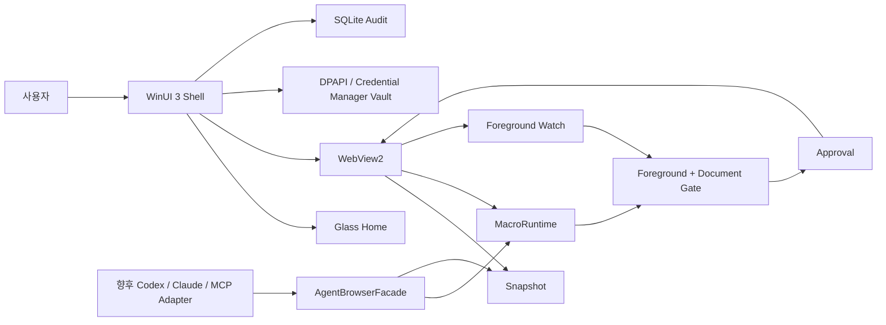

<div align="center">

# ✦ Luma

### 내 브라우저. 내 공간. 필요한 만큼만 AI.

**몽글몽글한 글래스 홈, 로컬 자동화, 보이는 AI 작업 전달을 갖춘 가벼운 Windows 개인용 브라우저.**

<br />

[](#빌드)
[](#기술-스택)
[](#기술-스택)
[](#기술-스택)

[English](README.md) · [아키텍처](docs/ARCHITECTURE.md) · [보안](docs/SECURITY.md) · [로드맵](docs/ROADMAP.md) · [Glass Home & Agent](docs/HOME_AND_AGENT.md)

<br />

**평소에는 브라우저처럼 · 반복 작업만 자동화 · 마지막 통제권은 사람에게**

</div>

---

## 브라우저가 먼저다

Luma는 AI 채팅 페이지에 브라우저 모양을 씌운 프로젝트가 아니다. **WinUI 3 + WebView2 기반 실제 개인용 브라우저** 위에 필요한 자동화만 얹는 방향이다.

설계 목표는 **Intel Core i5 13세대 + RAM 8 GB** 정도의 Windows PC다. 대형 로컬 LLM을 상주시킬 필요가 없고 Chromium을 한 벌 더 번들하지 않는다.

```text
사용자
 │
 ▼
Luma
 ├─ WebView2 브라우징
 ├─ Glass Home
 ├─ DOM Snapshot
 ├─ 의미 기반 Macro
 ├─ Foreground Watch
 ├─ Local Vault
 └─ Claude / Gemini 보이는 작업 전달
```

---

## 문제 해결 과정과 검증

Luma의 중심은 기능 나열이 아니라 **저사양 Windows 브라우저에서 신뢰 경계를 유지하며 자동화를 제한하는 설계**입니다.

- **문제:** 웹페이지의 DOM과 외부 AI의 출력은 실행 권한을 부여할 수 없는 데이터입니다.
- **선택:** 허용된 매크로만 선택된 실제 전경 탭에서 실행하고, 클릭 승인 이후에도 문서·대상을 다시 검사합니다. 이미 전송된 클릭을 무작정 재시도하지 않습니다.
- **대가:** 완전 무인 실행보다 사용자 통제와 실패 억제를 우선합니다. 외부 Codex/MCP 제어 서버, 이메일·예약 자동 대행은 아직 구현하지 않았습니다.
- **검증 한계:** Windows CI·회귀 테스트 소스는 있으나, 8GB 실환경의 실측 성능이나 모든 실제 사이트 호환성을 입증하지는 않습니다.

**[한국어 기술 사례 연구](docs/ENGINEERING_CASE_STUDY.ko.md)** · [English](docs/ENGINEERING_CASE_STUDY.md) · [보안과 한계](docs/SECURITY.md)

---

## 🫧 Glass Home

이제 새 탭을 열면 Google 빈 화면 대신 **Luma 자체 로컬 대시보드**가 열린다.

방향은 화려한 네온이 아니라, 말 그대로 **몽글몽글한 유리 느낌**이다.

- 반투명 글래스 카드
- 둥근 모서리
- 은은한 정적 그라데이션
- 과하지 않은 blur / shadow
- 짧은 등장 애니메이션
- 다크 모드 및 `prefers-reduced-motion` 대응
- 뉴스·날씨·광고·외부 스크립트 없음

홈 주소는 `https://luma.local/home.html`이지만 네트워크 사이트가 아니라 WebView2가 로컬 폴더를 매핑한 내부 페이지다.

| 위젯 | 기능 |
|---|---|
| ⭐ Favorites | 직접 추가/편집하는 자주 가는 사이트 |
| ⚡ Quick Actions | 새 검색, 매크로 녹화, Watch, Vault, Agent 패널 |
| 🕘 Recent | 로컬 SQLite 감사로그의 최근 사이트 origin |
| 📝 Quick Note | Home origin에만 저장되는 간단 메모 |
| ◉ Automation | 매크로/Watch 상태와 Stop 버튼 |
| 🕒 Today | 인사말, 날짜, 시간 |

포털처럼 이것저것 채우는 홈이 아니라 **Luma에서 바로 다음 작업을 시작하는 홈**으로 잡았다.

---

## 지금 되는 것

<table>
<tr><td width="50%" valign="top">

### 🌐 브라우징

- WebView2 영구 프로필
- 여러 탭
- 주소/검색창
- 뒤로 / 앞으로 / 새로고침 / 홈
- 팝업을 새 탭으로 열기
- 비활성 탭 메모리 절약

</td><td width="50%" valign="top">

### ⚙️ 로컬 자동화

- 구조화된 DOM Snapshot
- 클릭/탐색 기록
- 검증된 JSON Macro
- `navigate`, `click`, `input`, `wait`
- `retry`, `if`, `loop`
- 취소 / 시간 / 작업 수 제한

</td></tr>
<tr><td valign="top">

### 👁 Foreground Watch

- 정확한 표시 텍스트 감시
- 3초 주기 확인
- 감시 시간 제한
- 원래 탭/origin 고정
- 확인 후 클릭
- 성공 후 Macro Replay 선택

</td><td valign="top">

### 🔐 로컬 개인정보 보호

- DPAPI 기반 타입 Vault
- 로그인 비밀값은 Windows Credential Manager 선택 가능
- 안전한 로컬 폼 채우기
- SQLite 감사로그
- 전체 카드번호/CVV/PIN 필드 자체가 없음

</td></tr>
</table>

---

> **매크로 개인정보 보호:** 쿼리·프래그먼트·URL 사용자정보가 들어간 이동 주소는 자동 녹화하지 않습니다. 평문 JSON 내보내기와 로컬 저장은 입력값이 들어간 단계(중첩 포함) 또는 위험 주소를 거부합니다. 이전에 저장한 파일과 가져온 매크로의 메모리 내 데이터는 자동 삭제되지 않습니다. [보안 문서](docs/SECURITY.md)를 참고하세요.

## 사람 중심 자동화

Luma에서는 **AI가 원한다고 권한이 생기지 않는다.**

```text
페이지 관찰
  ↓
정확한 DOM 대상 검증
  ↓
현재 선택된 포그라운드 탭인지 확인
  ↓
필요한 클릭은 사용자 승인
  ↓
문서와 대상 다시 검증
  ↓
한 번만 실행
```

Macro Runtime은 전체 실행 시간, 작업 수, 중첩, 재시도, selector 중복을 제한한다. 민감 필드는 거부하고, 이미 보낸 효과를 무작정 다시 실행하지 않는다.

---

## 🤖 ego-lite에서 참고한 부분: 작은 Agent API

Luma가 ego-lite처럼 완전자율 Agent Browser가 될 필요는 없다. 대신 **좋은 부분인 작은 browser primitive + 묶음 실행 개념**은 가져올 가치가 있다.

그래서 `AgentBrowserFacade` 기반을 추가했다.

```text
SnapshotAsync()
NavigateAsync(url)
ClickAsync(selector)
FillAsync(selector, value)
WaitAsync(selector, condition)
ExecuteBatchAsync(steps)
```

핵심은 여러 번

```text
snapshot → AI → click → snapshot → AI → input ...
```

왕복하기보다, 검증 가능한 작은 프로그램 하나로 묶을 수 있게 만드는 것이다.

단, **현재는 내부 통합 레이어다.** localhost HTTP 서버나 MCP 원격제어 포트를 자동으로 열지 않는다. 즉 facade가 생겼다고 Codex/Claude가 몰래 Luma를 제어할 수 있는 구조가 된 것은 아니다.

앞으로 연결하더라도 기존의 foreground gate, DOM 검증, 클릭 승인, 취소 규칙을 그대로 통과해야 한다.

자세한 내용은 [`skills/luma-browser/SKILL.md`](skills/luma-browser/SKILL.md)와 [Glass Home & Agent](docs/HOME_AND_AGENT.md)를 참고.

---

## Claude / Gemini는 보이게 넘긴다

현재 AI handoff는 일부러 눈에 보인다.

```text
작업 입력
   ↓
민감정보 방어 처리
   ↓
사용자 검토
   ↓
Claude / Gemini 탭 열기
   ↓
직접 붙여넣고 전송
   ↓
선택한 답변만 untrusted text로 읽기
```

브라우저 쿠키, Vault 내용, 숨은 페이지 문맥이나 전체 대화를 자동으로 AI에게 붙이지 않는다.

---

## Local Vault

지원 슬롯:

- **Login** — 정확한 HTTPS origin, username, 보호된 password
- **Address** — 이름, 주소, 지역, 우편번호, 이메일, 전화번호
- **Payment metadata** — 브랜드, 끝 4자리, 명의자, 유효기간만

전체 카드번호, CVV/CVC, PIN은 애초에 저장 필드가 없다. Fill은 제출하지 않으며 결제 인증은 사람이 직접 한다.

---

## 구조



---

## 기술 스택

| 영역 | 기술 |
|---|---|
| UI | WinUI 3 / Windows App SDK |
| Runtime | .NET 8 |
| Browser | Microsoft Edge WebView2 |
| Local DB | SQLite |
| Secret | Windows DPAPI / Credential Manager |
| Automation | DOM JavaScript bridge + bounded C# runtime |
| CI | GitHub Actions `windows-latest` |
| DOM 회귀 테스트 | Node.js 22 |

---

## 빌드

필요 환경:

- Windows x64
- .NET 8 SDK
- Windows App SDK 빌드 도구
- WebView2 Evergreen Runtime

```powershell
git clone https://github.com/homesweetlove/Luma.git
cd Luma

dotnet restore src/Luma/Luma.csproj -p:Platform=x64 --locked-mode
dotnet build src/Luma/Luma.csproj -c Release -p:Platform=x64 --no-restore
```

타깃은 `net8.0-windows10.0.19041.0`이다.

---

## 검증

`main` push와 `main` 대상 PR마다 GitHub Actions에서 Windows Release 빌드와 behavioral/Vault/Foreground Watch 회귀 테스트를 실행한다.

로컬에서는:

```powershell
dotnet restore tests/Luma.Tests/Luma.Tests.csproj -p:Platform=x64 --locked-mode
dotnet build tests/Luma.Tests/Luma.Tests.csproj -c Release -p:Platform=x64 --no-restore
dotnet tests/Luma.Tests/bin/x64/Release/net8.0-windows10.0.19041.0/win-x64/Luma.Tests.dll
node tests/ForegroundWatchTests.js
```

---

## 아직 안 하는 것

- CAPTCHA 우회
- OTP / Passkey 우회
- 결제 인증 자동화
- 인증 없는 localhost 원격제어 API
- 완전 자율 checkout
- 숨겨진 백그라운드 예약 봇
- 상주 대형 로컬 LLM

기능을 추가하더라도 기존 안전 경계를 **우회하지 않고 그 안쪽에 추가**하는 게 Luma 방향이다.

---

<div align="center">

### ✦ Luma

**Browse · Automate · Delegate · Stay in control**

</div>
