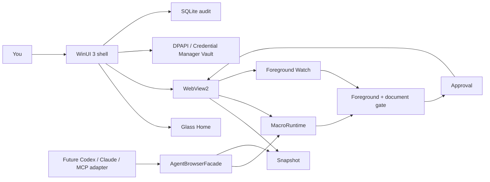

<div align="center">

# ✦ Luma

### Your browser. Your space. Your AI.

**A lightweight personal Windows browser with a soft glass home, local automation, and visible AI handoffs.**

<br />

[](#build)
[](#tech)
[](#tech)
[](#tech)

[한국어](README.ko.md) · [Architecture](docs/ARCHITECTURE.md) · [Security](docs/SECURITY.md) · [Roadmap](docs/ROADMAP.md) · [Glass Home & Agent](docs/HOME_AND_AGENT.md)

<br />

**Browse normally · automate the repetitive parts · keep the person in control**

</div>

---

> [!NOTE]
> **Development preview — source code only.** No signed Windows installer or stable release is available yet. Build on Windows x64 using the steps below, and test with non-sensitive data before using local automation or the Vault on real accounts. Actual-device compatibility and 8 GB performance are still being verified.

## A browser first

Luma is not an AI chat page pretending to be a browser. It is a WinUI 3 + WebView2 browser for personal Windows use, with bounded local automation layered on top.

The design target is a **13th-generation Intel Core i5 with 8 GB RAM**. Luma does not keep a large local model resident and does not bundle a second Chromium runtime.

```text
You
 │
 ▼
Luma
 ├─ WebView2 browsing
 ├─ Glass Home
 ├─ DOM snapshots
 ├─ semantic macros
 ├─ Foreground Watch
 ├─ typed local Vault
 └─ visible Claude / Gemini handoff
```

---

## Engineering case study

Luma is an experiment in **bounded browser automation under resource and trust constraints**, rather than an autonomous assistant claiming to complete every workflow.

- **Problem:** how can untrusted webpages and external AI suggestions be observed without giving them native execution authority?
- **Decision:** execute validated macro steps only in the selected, OS-foreground tab; recheck document identity after click approval, and never blindly retry an effect after dispatch.
- **Trade-off:** this design favors user control and failure containment over unattended operation. No Codex/MCP remote-control server or autonomous mail/reservation integration is currently provided.
- **Validation boundary:** the repository contains a Windows CI workflow and behavioral/DOM test suites, but browser performance on the 8 GB target and broad real-site compatibility are not published benchmarks.

**[Read the engineering case study](docs/ENGINEERING_CASE_STUDY.md)** · [한국어](docs/ENGINEERING_CASE_STUDY.ko.md) · [Security and limitations](docs/SECURITY.md)

---

## 🫧 Glass Home

New tabs now open a local Luma dashboard instead of a plain Google page.

The home surface uses soft glass cards, rounded geometry, static gradient light, restrained blur and short motion. It stays local at `https://luma.local/home.html`; it does **not** load news, weather, ads, analytics or remote JavaScript.

| Widget | What it does |
|---|---|
| ⭐ Favorites | Editable shortcuts stored in the WebView2 profile |
| ⚡ Quick actions | Search, record, watch, Vault, agent panel |
| 🕘 Recent | Recent site origins from the local SQLite audit log |
| 📝 Quick note | A small local note stored in the Home origin |
| ◉ Automation | Shows macro/watch state and offers a stop action |
| 🕒 Today | Local greeting, date and time |

The home page is deliberately a **browser workspace**, not a portal homepage.

---

## What works today

<table>
<tr><td width="50%" valign="top">

### 🌐 Browsing

- persistent WebView2 profile
- multiple tabs
- address/search bar
- back / forward / reload / home
- popup-to-tab handling
- inactive-tab memory reduction

</td><td width="50%" valign="top">

### ⚙️ Local automation

- structured DOM snapshot
- click/navigation recording
- validated JSON macros
- `navigate`, `click`, `input`, `wait`
- `retry`, `if`, `loop`
- cancellation and execution budgets

</td></tr>
<tr><td valign="top">

### 👁 Foreground Watch

- exact visible text matching
- 3-second checks
- bounded schedule
- original tab/origin binding
- optional confirmed click
- optional follow-up macro replay

</td><td valign="top">

### 🔐 Local privacy

- DPAPI-protected typed Vault
- optional Windows Credential Manager for login secrets
- safe local form fill
- SQLite audit log
- full PAN/CVV/PIN intentionally unsupported

</td></tr>
</table>

---

> **Macro privacy update:** recording skips navigation URLs that contain query strings, fragments or embedded credentials. Plaintext JSON export and local save now refuse input-value steps (including nested steps) and unsafe navigation URLs. Imported macros can still contain private values in memory, and previously saved files are not changed automatically. See [Security](docs/SECURITY.md).

## Saved macros, visual editor and AI planning

- **Saved macros:** Open **Saved macros** in the Agent panel to name and save the current validated program or load an existing one from `%LOCALAPPDATA%\Luma\Macros`. They are local plaintext presets, not cloud-synced or encrypted; input values and unsafe navigation URLs cannot be saved.
- **Visual editor:** Open **Visual editor** to add, reorder or remove steps, edit selectors/conditions/timeouts, and create nested `if`/`else`, `loop` and `retry` blocks. Changes stay in a separate working copy until **Apply macro** validates the entire program. Discard leaves the active macro unchanged.
- **AI macro plan:** Describe an action in **AI MACRO PLAN**, choose Gemini or Claude, review the sanitized prompt and manually send it in the visible provider tab. Select only its JSON response, click **Review selected AI plan**, inspect the validated steps, and explicitly **Load for editing**. **Replay is a separate action**; clicks still require native approval.

This is a visible, user-reviewed AI handoff, **not** automatic model/API integration or unsupervised browsing. AI plans reject input steps, credential-bearing URLs, unsupported actions and self-healing. Unknown CSS selectors must be corrected in the editor before replay. The source-only preview has no signed Windows installer yet.

## Human-first automation

Luma does not treat model output as permission.

```text
Observe
  ↓
Validate exact DOM target
  ↓
Check selected foreground tab
  ↓
Ask for click approval when required
  ↓
Revalidate document + target
  ↓
Dispatch once
```

Macro execution keeps hard limits on time, operation count, nesting, retries and selector ambiguity. Sensitive inputs are refused. A dispatched effect is never blindly retried.

---

## 🤖 Agent-ready, not agent-owned

Luma now contains a small transport-agnostic `AgentBrowserFacade` inspired by the useful part of dedicated agent browsers: **compose several browser operations into one validated run instead of burning tokens on endless tiny tool calls**.

The preview contract includes:

```text
SnapshotAsync()
NavigateAsync(url)
ClickAsync(selector)
FillAsync(selector, value)
WaitAsync(selector, condition)
ExecuteBatchAsync(steps)
```

Important: this is currently an **internal integration surface**, not an exposed localhost/MCP remote-control server. External agents cannot silently take over Luma just because the facade exists.

Any future Codex/Claude/MCP adapter must reuse the same foreground gate, DOM validation, click approval and cancellation rules.

See [`skills/luma-browser/SKILL.md`](skills/luma-browser/SKILL.md) and [Glass Home & Agent](docs/HOME_AND_AGENT.md).

---

## Visible AI handoff

Claude and Gemini delegation stays deliberately visible:

```text
bounded task
   ↓
privacy preparation
   ↓
user review
   ↓
visible provider tab
   ↓
manual paste / send
   ↓
selected reply imported as untrusted text
```

Luma does not automatically attach cookies, Vault content, hidden page context or a full conversation to a provider.

---

## Local Vault

The typed Vault supports:

- **Login** — exact HTTPS origin, username, protected password
- **Address** — name, address, region, postal code, email, phone
- **Payment metadata** — brand, last four, holder and expiry only

Luma intentionally has no fields for a full card number, CVV/CVC or PIN. Fill never submits a form and authentication remains manual.

---

## Architecture



---

## Tech

| Layer | Technology |
|---|---|
| UI | WinUI 3 / Windows App SDK |
| Runtime | .NET 8 |
| Browser | Microsoft Edge WebView2 |
| Local database | SQLite |
| Secret protection | Windows DPAPI / Credential Manager |
| Automation | DOM JavaScript bridge + bounded C# runtime |
| CI | GitHub Actions on `windows-latest` |
| DOM regression tests | Node.js 22 |

---

## Build

Requirements:

- Windows x64
- .NET 8 SDK
- Windows App SDK build tooling
- WebView2 Evergreen Runtime

```powershell
git clone https://github.com/homesweetlove/Luma.git
cd Luma

dotnet restore src/Luma/Luma.csproj -p:Platform=x64 --locked-mode
dotnet build src/Luma/Luma.csproj -c Release -p:Platform=x64 --no-restore
```

Luma targets `net8.0-windows10.0.19041.0`.

---

## Verification

The repository CI performs a Windows Release build plus behavioral, Vault and Foreground Watch regression checks on every push to `main` and every pull request targeting `main`.

For local verification:

```powershell
dotnet restore tests/Luma.Tests/Luma.Tests.csproj -p:Platform=x64 --locked-mode
dotnet build tests/Luma.Tests/Luma.Tests.csproj -c Release -p:Platform=x64 --no-restore
dotnet tests/Luma.Tests/bin/x64/Release/net8.0-windows10.0.19041.0/win-x64/Luma.Tests.dll
node tests/ForegroundWatchTests.js
node tests/HomeDashboardTests.js
```

---

## Boundaries

Luma has no CAPTCHA, passkey, OTP or payment-challenge bypass. It does not currently expose an authenticated remote agent transport, autonomous checkout engine, mail/calendar connector, shell tool or hidden background reservation service.

That is intentional: new capability should be added **behind the existing safety boundary**, not around it.

---

<div align="center">

### ✦ Luma

**Browse · Automate · Delegate · Stay in control**

</div>

## License

Project-authored source code is licensed under the [MIT License](LICENSE). Third-party dependencies retain their own license terms.
