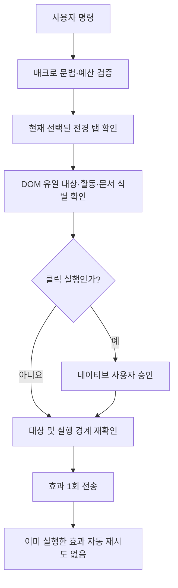

# Luma — 엔지니어링 사례 연구

> **핵심:** Windows 브라우저 구조, 제한된 자동화, 사용자 승인·개인정보 경계  
> **기술:** C# / .NET 8 · WinUI 3 · WebView2  
> **현재 단계:** 실행 코드와 자동 회귀 테스트가 있는 개인용 프로젝트. **자율 AI 브라우저 완성 또는 8GB 성능 검증을 의미하지 않음.**

[English](ENGINEERING_CASE_STUDY.md) · [아키텍처](ARCHITECTURE.md) · [보안](SECURITY.md) · [로드맵](ROADMAP.md)

## 1. 발견한 문제

브라우저에 AI 자동화 기능을 얹으면 편리해질 수 있지만, 웹페이지는 신뢰할 수 없는 입력이고 모델의 답변도 실행 권한 자체가 아닙니다. 클릭·입력·페이지 이동이 사용자 의도와 다른 결과로 이어지면 기존 작업이나 계정에 영향을 줍니다. 메모리가 제한된 PC에서는 별도 Chromium 엔진이나 대형 모델을 상주시키는 것도 부담이 됩니다.

**질문:** 브라우저의 기본 기능을 유지하면서, 자동화의 관찰·판단·승인·실행을 분리할 수 있을까?

## 2. 설계 선택과 대가

| 문제 | 선택한 방식 | 포기하거나 남긴 부분 |
| --- | --- | --- |
| 웹 호환성과 구현 비용 | WinUI 3 네이티브 UI + WebView2 사용 | Windows 종속, Evergreen 설치 필요 |
| 사람이 사용 중인 탭 보호 | 실제 OS 전경 창·선택한 탭 확인 | 백그라운드 무인 실행 불가 |
| 의도치 않은 중복 클릭 | 실행 전 준비 상태만 재시도, 실행 후 효과 재시도 금지 | 이미 전송한 클릭은 취소해도 회수 불가 |
| 무제한 AI 실행 위험 | 허용된 매크로 명령·시간·작업 수·중첩 한도·클릭 승인 | 외부 MCP 제어기·범용 계획기는 아직 없음 |
| 비밀 정보 노출 위험 | DPAPI 기반 타입 Vault, 엄격한 폼 입력 경계, 수동 AI 전달 | 같은 Windows 계정의 악성 프로그램까지 방어하지 않음 |
| 저사양 대응 | 기존 WebView2 활용, 비활성 탭 일시 중지 시도 | 8GB에서 실제 성능 이득 수치는 아직 미측정 |

## 3. 자동화 실행 경계

실제 코드: [MacroRuntime](../src/Luma/Services/MacroRuntime.cs), [MacroService](../src/Luma/Services/MacroService.cs), [ForegroundWatch](../src/Luma/Services/ForegroundWatchService.cs), [MainWindow](../src/Luma/MainWindow.xaml.cs).

클릭 대상이 여러 개이거나 비밀번호 등 민감한 입력으로 판단되거나, 승인 전후 문서가 바뀌면 조치를 거부합니다. 다만 이 정책이 모든 사이트의 의도를 자동 파악한다는 뜻은 아닙니다. 반복 매크로는 명시적 조건 안에서 실행할 수 있지만 결제·예약의 의도를 일반적으로 자동 인식하는 거래 엔진은 구현돼 있지 않습니다.

## 4. AI 연동을 어디까지 구현했는가

`AgentBrowserFacade`에는 snapshot, navigate, click, fill, wait, batch 실행을 구성하는 내부 API가 있습니다. **하지만 외부 Codex·Claude·MCP가 직접 연결하는 통신 서버가 아닙니다.** 현재 Claude/Gemini 전달은 작업을 검토하고 브라우저에서 직접 붙여 넣고 보내는 *보이는 핸드오프* 방식입니다. 모델 응답은 곧바로 실행 명령이 되지 않습니다.

보안 정책에 이메일·일정·예약·구매 등의 이름이 등장하지만, 이를 처리할 외부 서비스 연결은 아직 없습니다. 결제/메일 자동 대행이 구현된 것처럼 소개하지 않습니다.

## 5. 점검 중 발견한 실제 문제

- **녹화 중지 오인식:** 기존 명령 파서는 '매크로 녹화 중지'를 시작 명령으로 먼저 분류했습니다. 중지 명령을 먼저 확인하도록 수정하고 테스트를 추가했습니다.
- **매크로 입력값 노출:** 가져온 매크로의 `ToString()` 표현이 입력값 원문을 UI 리스트에 표시했습니다. 미리보기에서는 입력값을 가리도록 수정했습니다. 이것이 저장된 JSON 암호화를 의미하지는 않습니다.

수정: [LocalIntentRouter](../src/Luma/Services/LocalIntentRouter.cs) · [AutomationModels](../src/Luma/Models/AutomationModels.cs) · [회귀 테스트](../tests/Luma.Tests/Program.cs).

## 6. 확인된 근거와 미검증 범위

| 분야 | 근거 | 남은 검증 |
| --- | --- | --- |
| 브라우저 | WinUI 3·WebView2 창·탭 코드 | 깨끗한 PC 설치, 사이트별 호환성 |
| 매크로 | `MacroRuntime` 및 [테스트](../tests/AutomationRuntimeTests.cs) | 실제 사이트의 변경·지연·실패 복구 |
| 감시 | `ForegroundWatchService`·Node DOM 테스트 | OS 절전 해제·정확한 백그라운드 예약 |
| Vault | DPAPI 구현·[보안 문서](SECURITY.md)·필드 테스트 | 외부 보안 감사, 포괄적 비밀 탐지 |
| AI | 수동·가시적 Claude/Gemini 전달 | 자동 모델 실행·MCP 원격 연결 |
| 성능 | 저사양 기준의 설계 의도 | 실제 8GB 메모리·CPU·시작 시간 측정 |

Windows CI 워크플로와 테스트 코드가 존재합니다. **이 문서를 작성하면서 실제 Windows 빌드나 WebView2 UI 테스트를 새로 실행하지는 않았습니다.**

## 7. 다음 검증 과제

실제 WebView에서 전경 전환·승인 중 페이지 이동·탭 종료·취소·Vault 채우기를 확인해야 합니다. Claude/Gemini 로그인과 수동 전달 동작도 사이트 변경을 고려해 검증해야 합니다. 메모리 소비를 측정하기 전에는 '빠르다'거나 'RAM을 절약한다'는 성능 수치를 주장하지 않습니다.

**포트폴리오에서의 핵심 역량:** 여러 자동화 기능을 만들었다는 것보다, 신뢰할 수 없는 웹 입력과 사용자 명령의 경계를 구분하고 실패·복원·취소를 고려해 실행 구조를 설계했다는 것입니다.
