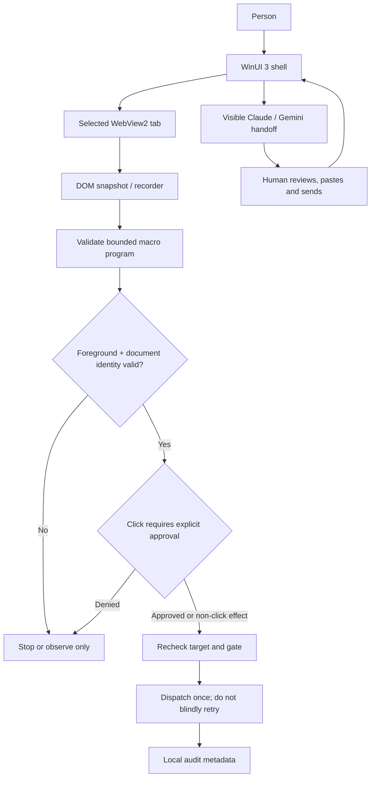

# Luma — Engineering Case Study

> **Role:** desktop/browser systems engineering, human-in-the-loop automation and privacy boundaries  
> **Platform:** Windows x64 · C#/.NET 8 · WinUI 3 · WebView2  
> **State:** implementation and automated regression assets exist. **Not** a production-ready, self-directed AI browser or measured low-memory performance claim.

[한국어 사례](ENGINEERING_CASE_STUDY.ko.md) · [Architecture](ARCHITECTURE.md) · [Security](SECURITY.md) · [Roadmap](ROADMAP.md) · [README](../README.md)

## The real problem

An AI-driven browser sounds attractive, but a browser must first preserve predictable navigation, the user's existing sessions, and their ability to cancel or refuse actions. On a resource-constrained PC, running a second browser engine or a permanent large language model is also a poor default.

**Design question:** Can ordinary browser controls be combined with bounded, auditable automation **without transferring the right to execute actions from the person to model-generated text or an untrusted web page?**

The project intentionally treats three types of content differently:

1. **User interface and native host:** locally trusted application code and explicit approvals.
2. **Visited webpages:** untrusted DOM, including text, input fields and page-supplied events.
3. **External AI replies:** untrusted suggestions, never automatically converted into execution authority.

## Engineering trade-offs

| Constraint | Decision visible in source | Cost / unresolved work |
| --- | --- | --- |
| Browser compatibility without a full new engine | Native WinUI 3 shell with existing WebView2 runtime | Microsoft WebView2 Evergreen dependency, Windows only |
| Protect active interaction | OS-foreground-window and selected-tab gate; checks before effects | Automated workflows pause/stop on focus loss; not an unattended browser |
| Prevent accidental repeated actions | Readiness retries only; no retry after dispatched click/input/navigation | In-flight effects cannot be recalled when cancellation arrives |
| Avoid arbitrary model privileges | Structured `MacroStep` kinds and validation, click approval, operation/time/depth budgets | No external Codex/MCP transport, automatic planner or universal website support |
| Protect private browser data | Typed DPAPI Vault, narrow form-fill rules, manual AI handoff | Same Windows account boundary; WebView profile, audit DB and exported macros are not end-to-end encrypted |
| Design for small PCs | Reuse WebView2; suspend inactive tabs best-effort | Actual cold-start, total process RAM and responsiveness on 8 GB are **unmeasured** |

These are design decisions and code paths, not a claim that Luma is secure against every webpage or that its memory footprint is already proven low.

## Execution boundary

**Where it is implemented:**
- [MacroRuntime.cs](../src/Luma/Services/MacroRuntime.cs): validates step grammar, budgets, loops, readiness retry, gate, click approval and post-approval target/document recheck.
- [MacroService.cs](../src/Luma/Services/MacroService.cs): records permitted click/navigation events and performs DOM operations through the WebView host.
- [ForegroundWatchService.cs](../src/Luma/Services/ForegroundWatchService.cs): checks a known visible target on the original tab; any approved click is revalidated.
- [MainWindow.xaml.cs](../src/Luma/MainWindow.xaml.cs): foreground/selected-tab policy, approvals, cancellation and UI integration.
- [AgentBrowserFacade.cs](../src/Luma/Services/AgentBrowserFacade.cs): internal composition contract, **not** an exposed remote-control API.

**Important nuance:** the approval policy enum lists transactions, purchases, email and Git actions, but these services are not implemented by the enum. Plain UI navigation is not the same as an integrated booking, mail or OS automation service.

## One concrete issue found during review

The local command parser checked for “macro” + “record” before “stop recording”, so **“매크로 녹화 중지”** was classified as a start command. The review patch gives stop commands precedence and adds behavioral tests.

The `MacroStep.ToString()` representation also echoed imported input values in the native macro list. The patch hides the input value in the preview. This does **not** encrypt an imported macro or prevent the target website from reading a value typed into its own input field.

See [LocalIntentRouter.cs](../src/Luma/Services/LocalIntentRouter.cs), [AutomationModels.cs](../src/Luma/Models/AutomationModels.cs) and [behavioral test runner](../tests/Luma.Tests/Program.cs).

## Evidence and limits

| Area | Evidence in repository | What remains unproven |
| --- | --- | --- |
| Core browsing | WinUI and WebView2 controls in `src/Luma/` | Complete clean-machine install/upgrade support |
| Automation | Interpreter + [behavioral suite](../tests/AutomationRuntimeTests.cs) | Unbounded compatibility with arbitrary commercial websites |
| Watch | [watch service](../src/Luma/Services/ForegroundWatchService.cs) and [DOM regression tests](../tests/ForegroundWatchTests.js) | Guaranteed timing, background wakeups or reservations |
| Privacy | [Security](SECURITY.md), [Vault tests](../tests/VaultTests.cs), [DOM fill tests](../tests/VaultAutofillTests.js) | An external security audit or universal secret detection |
| AI integration | Visible browser-tab delegate | Autonomous model planning or authenticated programmatic agent control |
| Resource use | Design targets 8 GB machines | A reproducible comparison with browser baselines or memory budgets |

A [GitHub Actions workflow](../.github/workflows/build.yml) defines a Windows build, .NET test runner and Node DOM tests. This document update did **not** itself execute Windows or WebView2 tests. A successful CI status, if obtained, is evidence of those automated checks only; it is not a physical-device or real-site acceptance test.

## Next validation milestones

- Capture repeatable browser startup and memory measurements before calling Luma “lightweight” as a measured fact.
- Exercise real WebView2 tabs with focus loss, same-URL reload, cancellation during approval, tab closure, and ambiguous controls.
- Test AI-provider login/clipboard/manual handoff without implying official provider integration.
- Explicitly test security and data retention policies for imported macro JSON, audit history and pre-existing vault files.
- Publish a short Windows UI demonstration after it is actually recorded and inspected.

**Portfolio takeaway:** Luma is best presented as a **boundary-first browser automation prototype**. Its value is the deliberate separation of intent, page observations, approvals and real effects—not the number of autonomous actions it claims to perform.
